# Bagi Fair 🍕

**Bagi adil, tanpa baper.** — _Fair splits, no drama._

Bagi Fair is a collaborative split-bill app for trips, shared rent, and hangouts. Everyone in a group can add expenses, see exactly how every number was calculated, and settle without a spreadsheet. Built with Flutter for **Android and Web**, backed directly by **Supabase** (Auth, Postgres, Realtime, Storage, Edge Functions).

**Live web demo:** <https://mtegarpamungkas.github.io/bagi-fair/>

<p align="center">
  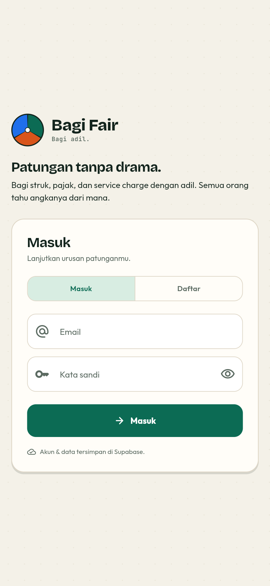
  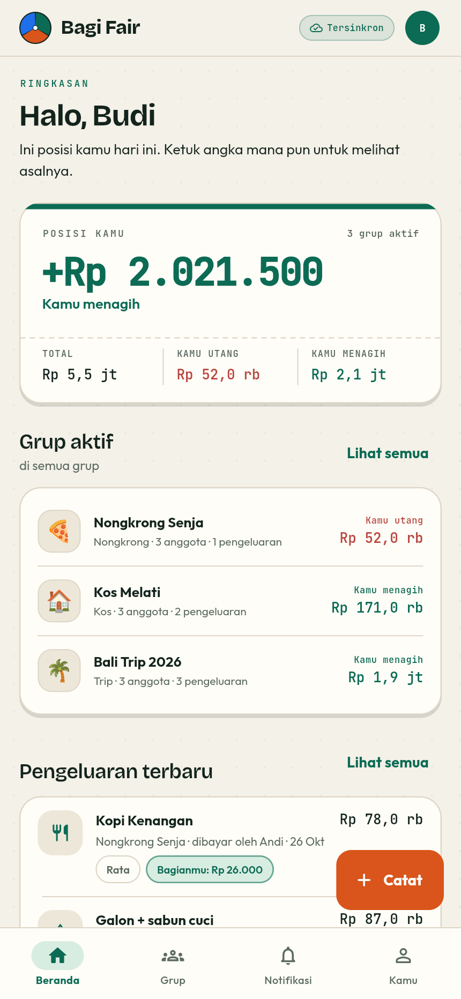
  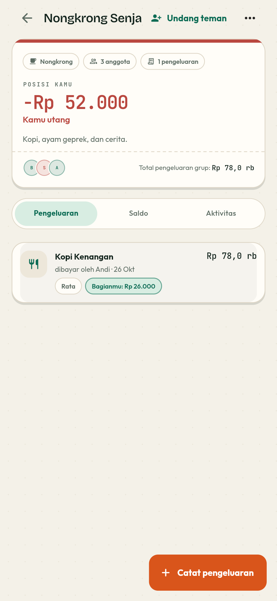
  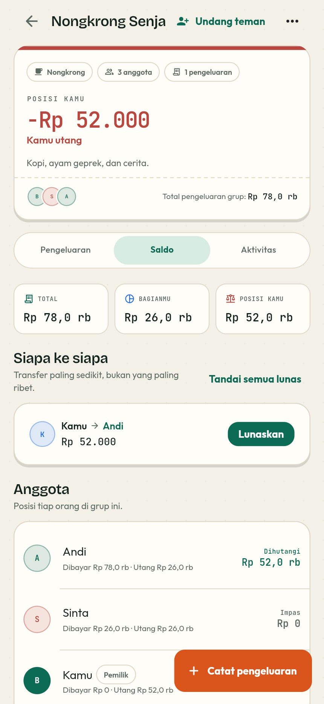
</p>

---

## What it does

| Area | What you get |
| --- | --- |
| Accounts | Email/password sign-up and sign-in through Supabase Auth, editable profile, per-user local cache |
| Groups | Trip, rent (kos), hangout, or other; emoji; base currency; archive; deep-link invites |
| Expenses | Payer, participants, date, category, notes, original currency + FX rate, receipt link |
| Splits | Equal, percentage (basis points), custom exact amounts, and per-item assignment |
| Adjustments | Tax, service, and discount allocated proportionally to item subtotals, with explicit rounding |
| Debt | Net balances, simplified transfers (≤ n − 1), settle up, settlement history, "Impas" state |
| Transparency | "Kenapa angkanya segini?" breakdown per person, group activity timeline, share to WhatsApp |
| Receipts | Camera/gallery → AI OCR via Edge Function → editable review → manual fallback |
| Comfort | Material 3, light/dark, Indonesian/English, responsive phone/web, 48 dp targets |
| Collaboration | Supabase Realtime as a change signal, in-app notifications, gentle "Colek Halus" nudges |
| Export | Client-side PDF and CSV per group |

### The instrument-panel view: balances first

The home screen is not a generic finance dashboard. It opens with **your net position**, then the three numbers that explain it, then one ledger row per group answering a single question: _do I owe, am I owed, or are we even?_ Green means you are owed; red means you owe; the "Impas" stamp means nothing is left.

### "Fair" is a computation, not a slogan

- **4 split modes** — equal, percentage, exact, or per item.
- **Proportional tax & service** — allocated by each person's item subtotal, never flat.
- **Deterministic rounding** — largest-remainder allocation, so shares always add up to the total.
- **Plain-language breakdown** — every share opens its subtotal, tax, service, discount, and rounding lines.

---

## Screens

| Light | Dark |
| --- | --- |
|  | 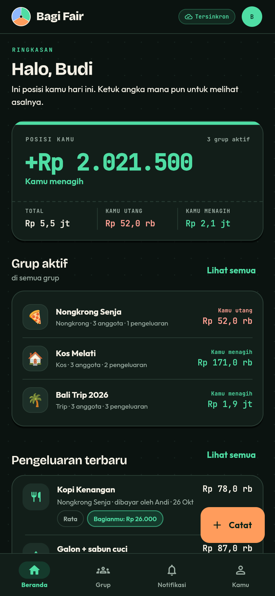 |
| 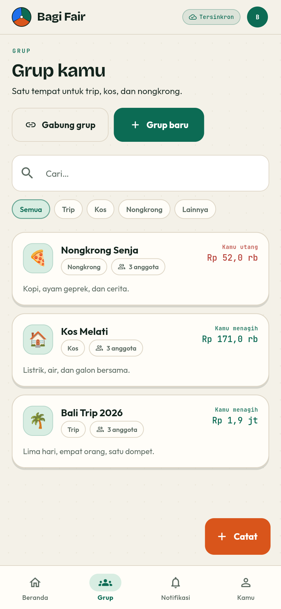 | 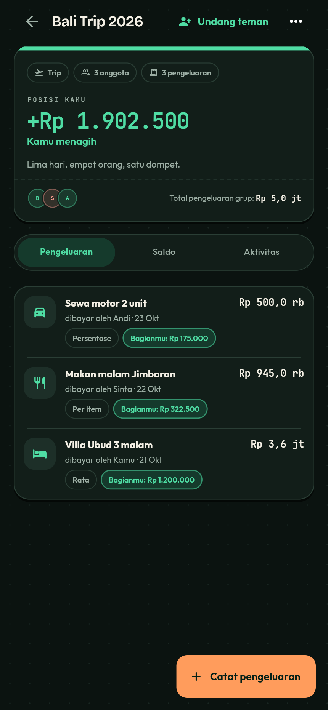 |
| 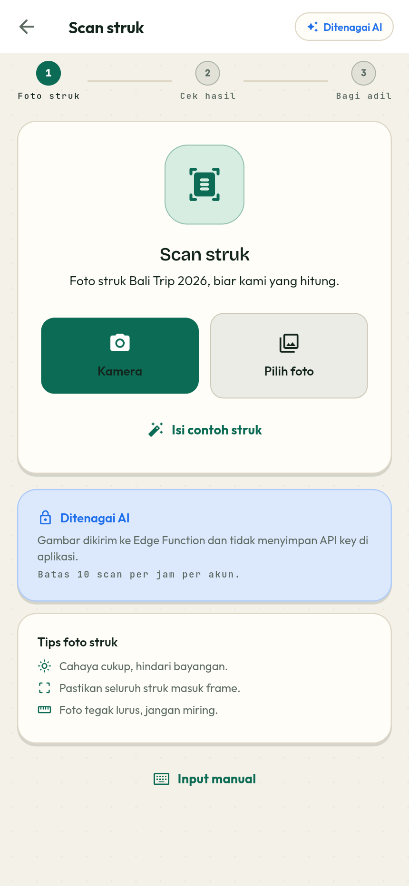 | 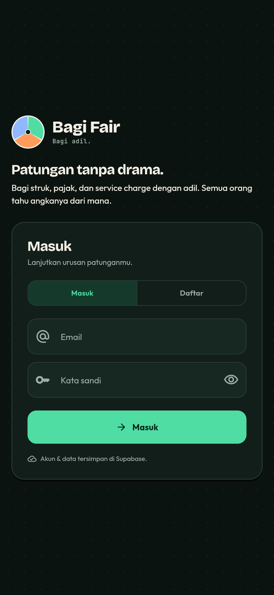 |

Desktop/web uses a side rail and a wider content column:

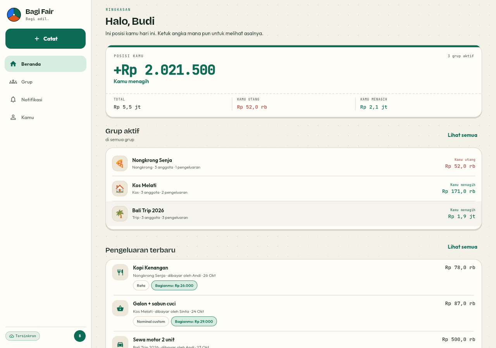

Receipts always pass through an editable review before they can become an expense:

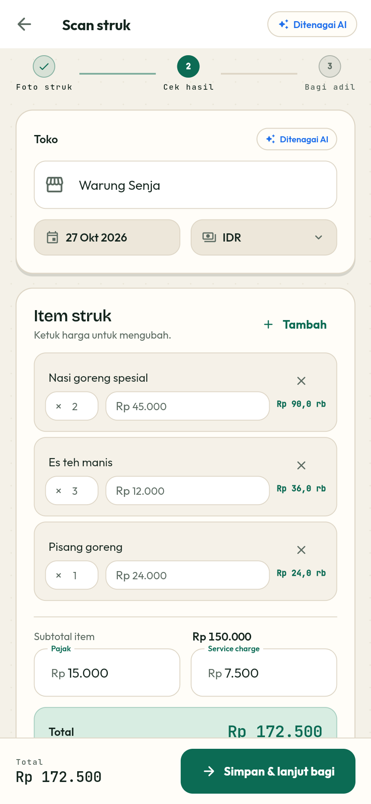

---

## Try it

### 1. Run the app (already connected)

The linked Supabase project is baked into `lib/core/config/app_config.dart` as the default (public anon key only). A plain run is a cloud run:

```bash
flutter pub get
flutter run
```

Create an account on the first screen, or use the seeded demo account:

```
email:    budi@bagifair.test
password: BagiFair123!
```

The seed contains **Bali Trip 2026**, **Kos Melati**, and **Nongkrong Senja** with members, expenses in all split modes, a settlement, activity, and a nudge. Re-seed any time with `node tools/seed-cloud.mjs` (the seeding script lives in the workspace root, not in the app bundle).

### 2. Point a fork at another project

```bash
flutter run --dart-define-from-file=env.json
```

`env.json` keys: `SUPABASE_URL`, `SUPABASE_ANON_KEY`, `APP_SCHEME`, `INVITE_HOST`. Only the anon key is used; **never** put a service-role key in the app.

### 3. Build

```bash
flutter build web --release
flutter build apk --release
```

For a signed release APK, configure `android/key.properties` and Gradle signing.

---

## Supabase setup

| | |
| --- | --- |
| Project ref | `tkjjpmwwvlvgydutnpls` |
| Region | `ap-south-1` |
| URL | `https://tkjjpmwwvlvgydutnpls.supabase.co` |
| CLI config | [`supabase/config.toml`](supabase/config.toml) |
| Migrations | `20261027000000_init`, `...0100_owner_visibility`, `...0200_account_deletion` |
| Edge Function | `scan-receipt` |

```bash
supabase db push --linked
supabase functions deploy scan-receipt --project-ref tkjjpmwwvlvgydutnpls
supabase secrets set GEMINI_API_KEY=<free-key> --project-ref tkjjpmwwvlvgydutnpls
# optional
supabase secrets set GEMINI_MODEL=gemini-2.0-flash --project-ref tkjjpmwwvlvgydutnpls
```

Get a free Gemini key at <https://aistudio.google.com/apikey>. Without the secret, the function returns `ai_not_configured`; the app says so and routes the user to editable manual entry instead of failing silently.

The migrations create ten tables with RLS, membership helpers, invite RPCs, a server-side AI quota (`claim_ai_scan`, service-role only), realtime publication, and a private `receipts` bucket. The project is managed as code; see [`DECISIONS.md`](DECISIONS.md) ADR-021.

### Auth configuration

Email/password is enabled. **Google sign-in is intentionally not wired yet** (the provider is disabled on the project), so the UI has no Google button. To add it later: create an OAuth client, add the Supabase callback URI, enable the provider, then add a repository method + button.

---

## Architecture

```
UI (pages + focused widget files)
   ↓ events / states
Bloc (flutter_bloc + Equatable)       ← GetIt builds feature blocs
   ↓
Use cases (pure Dart: SplitEngine, DebtSimplifier, …)
   ↓
Repositories (domain interfaces)
   ↓
LocalStore (Hive CE cache + outbox)  ←→  SyncEngine  ←→  Supabase
                                                          ├─ Auth
                                                          ├─ Postgres + RLS
                                                          ├─ Realtime
                                                          └─ Edge Function (OCR)
```

- **Bloc, not Cubit** — explicit events, immutable states, testable transitions.
- **Cloud is the source of truth; Hive is a cache and an offline outbox.** The same id is generated on the client so replaying an insert is idempotent.
- **Realtime is a change signal**, not a second source of truth: it triggers a debounced incremental pull, so all devices reconcile through one path.
- **Errors stay visible.** If a queued write fails, the sync chip keeps a short error and the pending item instead of pretending everything is idle.
- **Notification writes are explicit.** A new notification is a plain INSERT (nobody may read a row addressed to a friend), and read state is a PATCH on the columns that changed. Neither path upserts (ADR-034).
- **Baked cloud defaults.** No demo database and no fake rows; when the client cannot be created, the app shows an honest connection screen.

### Folder structure

```
lib/
├── app/                     # App, router, responsive shell, quick-add sheet
├── core/
│   ├── config/              # Compile-time AppConfig (Supabase defaults)
│   ├── di/                  # GetIt registrations
│   ├── localization/        # Compile-safe ID/EN strings
│   ├── responsive/          # Breakpoints and page padding
│   ├── theme/               # FairColors tokens, typography, Material 3 themes
│   ├── utils/               # Money, dates, enum parsing, stream helpers
│   └── widgets/             # 14 small UI files (see “Widget layout”)
├── domain/
│   ├── entities/            # Immutable models
│   ├── repositories/        # Interfaces + typed exceptions
│   └── usecases/            # SplitEngine, DebtSimplifier, use cases
├── data/
│   ├── datasources/         # Hive LocalStore, Supabase gateway
│   ├── repositories/        # Repository implementations
│   ├── services/            # Notifications, app links, sharing
│   └── sync/                # Outbox, pull cursor, realtime triggers
└── features/
    ├── auth/                # Page + brand panel + form card
    ├── home/                # Page + balance card, group ledger, recent list
    ├── groups/              # List, create, join, group card
    ├── group_detail/        # Page + header, menu, expenses/balances/activity tabs, sheets
    ├── expense_form/        # Page + controllers + basics, split mode, participants,
    │                        #   allocation, itemized editor, preview/why dialog
    ├── receipt_scan/        # Page + stepper, upload stage, review stage, save bar
    ├── notifications/       # Inbox and unread filter
    ├── profile/             # Identity card + editable fields
    ├── settings/            # Appearance, preferences, sync, export, about
    ├── shell/               # Global quick-add sheet
    └── sync/                # Sync status bloc
```

### Widget layout

The UI kit used to be one ~930-line file and the big pages were built from private
methods in one file each. They are now split so a screen can be read without
scrolling through everything:

- `core/widgets/`: `fair_background`, `brand_mark`, `paper_card`, `page_header`,
  `state_views`, `chips`, `money_text`, `avatars`, `group_type_icon`, `sync_chip`,
  `info_tiles`, `sheet_header`, plus the `fair_ui.dart` barrel.
- `expense_form/presentation/widgets/`: one file per form section + a controller bag.
- `receipt_scan/presentation/widgets/`: stepper, upload stage, review stage, save bar.
- `group_detail/presentation/widgets/`: header, menu, three tabs, existing sheets.
- `home/presentation/widgets/`: balance card, group ledger, recent expenses.

---

## Design language

The identity is a **shared receipt**, not a bank dashboard: warm paper, dark ink,
print-like rules, and a mark that is one circle cut into three equal wedges.

- **Palette** — warm paper `#F4F1E8`, pine green `#0C6B54`, tangerine `#D9551B`,
  ink `#13241D`, with a full dark scheme built from the same tokens.
- **Type** — *Bricolage Grotesque* for headlines, *Outfit* for UI, *JetBrains Mono*
  for every amount (tabular figures, so money columns line up).
- **Surface** — flat paper with a 1.2 px ink border and a hard 3 px offset shadow.
  No soft glows; that reads like a printed receipt on a table.
- **Details** — perforated dashed rules, rubber-stamp "IMPAS", a faint dot grid,
  and a global tangerine **Catat** action. The same three-wedge mark is the Android
  launcher and web app icon ([`docs/icon-master.png`](docs/icon-master.png)).
- **Motion** — restrained (160–180 ms) colour/indicator transitions; no decorative
  animation that delays reading a number.

Design tokens live in `lib/core/theme/app_theme.dart`; new colours and radii must
be added there, which keeps light/dark coherent.

---

## Money and split rules

### Integer minor units

All money is stored as integer minor units (`Rp 25.000` → `25000`, `$12.50` → `1250`).
`IDR`, `JPY`, `KRW`, and `VND` have zero decimals. No floating point drifts through
the database, the outbox, or exports.

### Deterministic allocation

1. Compute each participant's exact fractional share.
2. Floor every share to an integer.
3. Distribute the remaining units to the largest remainders.
4. Tie-break by participant order.

The sum always equals the total, and the result is identical on every device.

### Split modes

- **Equal** — total divided across selected participants.
- **Percentage** — weights in basis points (`5000` = 50%), validated to 100%.
- **Exact** — fixed minor-unit amounts whose sum must equal the total.
- **Per item** — item subtotals assigned to people (shared items split equally),
  then tax/service/discount allocated proportionally to those subtotals; receipt
  rounding is an explicit line, never hidden.

### Debt simplification

Net every balance, then repeatedly settle the largest debtor against the largest
creditor. This guarantees at most _n − 1_ transfers and is deterministic. It is
intentionally greedy: exact minimum-transfer is NP-hard, and an explainable result
matters more than saving one transfer in rare cases.

### Multi-currency

Each group has one base currency. An expense may use another with an `fx_rate` and
a precomputed `amount_base_minor`; balances and settlements always use the base
currency, while the original amount stays visible.

---

## Offline, sync, and realtime

- **Optimistic writes** — repositories write Hive immediately, then append to the
  `outbox`; the UI does not wait for a round trip.
- **Outbox replay** — `SyncEngine` pushes queued mutations in order when online and
  signed in. A failed push stops the cycle and keeps the error visible.
- **Pull** — on start, reconnect, realtime events, and debounced changes, the engine
  pulls rows newer than its `updated_at` cursor and upserts into Hive.
- **Conflict policy** — last write wins by `updated_at`; deletes are tombstones
  (except `group_members`, where presence is the row).
- **Realtime** — subscriptions on groups, members, expenses, settlements,
  activities, receipts, notifications, and profiles trigger one debounced pull.

---

## Security

- **RLS on every table.** Group-scoped tables check `is_group_member(group_id)`;
  profiles and notifications are owner-scoped.
- **Invites** are created/redeemed only through `create_group_invite` and
  `join_group_by_code` RPCs.
- **Receipts** live in a private bucket; storage policies derive the group from
  the object path.
- **AI quota** is enforced server-side (`claim_ai_scan`, 10/hour, service-role only).
- **Secrets** — the Gemini key and service-role key exist only in Supabase. The
  app ships the public anon key, protected by RLS.

---

## Testing

```bash
flutter analyze
flutter test
```

- **Money core:** equal/percentage/exact/per-item splits, proportional tax/service,
  rounding, money formatting/parsing for zero- and two-decimal currencies.
- **Debt simplification:** settles exactly and uses ≤ n − 1 transfers.
- **Enum mapping:** snake_case server rows and camelCase cache rows both parse;
  writes are snake_case.
- **Notifications:** a new notification is queued as an `insert`, marking it read
  is a `patch`, and duplicate inserts are treated as an idempotent replay.
- **Widgets:** shared `FairCard`/`EmptyState`/`AmountText`/`AvatarCircle`, `GroupCard`
  at 320 px, the auth screen (validation, sign-up toggle, wide layout, English), the
  new balance card (debt minus sign, credit plus sign, Impas stamp), group ledger,
  responsive `PageHeader`, perforated divider, and the receipt review stage.

CI (`.github/workflows/ci.yml`) runs analyze, tests, a web build, and a debug APK
build on every push and pull request. A second workflow
(`.github/workflows/pages.yml`) is the equivalent Pages pipeline.

Both workflows are **disabled on this repository** because the account's Actions
runners are currently blocked by a billing issue. The live demo is therefore
deployed from the **`gh-pages` branch** (a branch deploy needs no Actions minutes).
Once the account is healthy, re-enable them with:

```bash
gh workflow enable CI
gh workflow enable "Deploy web to GitHub Pages"
```

and switch **Settings → Pages → Source** back to *GitHub Actions*.

### Deploying the web build manually

```bash
flutter build web --release --base-href /bagi-fair/
# publish the contents of build/web to the gh-pages branch, with a .nojekyll file
```

The repository is `MTegarPamungkas/bagi-fair`, so the base href and the Pages URL
must match `/bagi-fair/`.

### Cloud / RLS smoke test

`scripts/cloud-smoke.ps1` exercises the deployed project through the public REST
API: anonymous access, sign-up, profile trigger, group creation, membership, invite
+ join, `member_count`, expense insert, cross-group isolation, receipt visibility,
notification insert, and rejection of `claim_ai_scan` / unauthenticated function
calls. It deletes its test users afterwards.

```powershell
$env:SUPABASE_SERVICE_ROLE_KEY = '<service-role-key>'   # local shell only
powershell -File scripts/cloud-smoke.ps1
```

---

## Known limitations

1. **Google sign-in is deferred** — email/password only until the provider is configured.
2. **Remote push is not wired** — in-app notifications sync through Supabase and local
   device reminders are scheduled; FCM/APNs fan-out is a future project.
3. **OCR needs a server secret** — set `GEMINI_API_KEY` on the Edge Function. Without
   it the app explains the state and falls back to manual entry.
4. **HTTPS app links need `assetlinks.json`** — the custom `bagifair://` scheme works now.
5. **Receipt signed URLs expire after 7 days** (re-signing on read is a follow-up).
6. **Android + Web only** — no iOS/macOS/Linux/Windows folders.
7. **Greedy settlement** — at most n − 1 transfers, not always the theoretical minimum.
8. **Last-write-wins** — no field-level merge UI.
9. **Account deletion** has a database cascade but no in-app screen yet.

---

## Fonts

Bundled under the SIL Open Font License 1.1: **Outfit**, **Bricolage Grotesque**, and
**JetBrains Mono**. See `assets/fonts/FONT-LICENSES.txt`.

## License

Educational/portfolio project. See [`DECISIONS.md`](DECISIONS.md) for the architecture
decision record.
